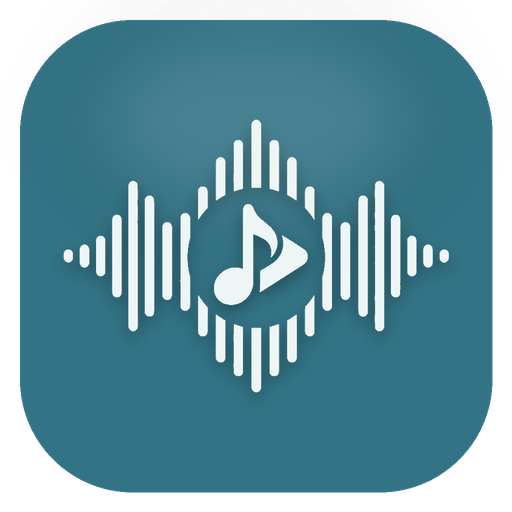

<div align="center">



# TuneGlass v1.0.0

**High-Resolution Lossless Music Streaming & Player with Real-Time Synced Lyrics & Smart Discovery for Android, built with Material 3 Expressive design.**

<p align="center">
  <a href="#">
    
  </a>
  <a href="#">
    
  </a>
  <a href="#">
    
  </a>
  <a href="#">
    
  </a>
</p>

</div>

<br/>

##  Overview

**TuneGlass** is a native Android music streaming app engineered for audiophiles and music lovers. It delivers studio-quality **Hi-Res Lossless FLAC (up to 24-bit/192kHz)** and Opus playback, offline downloads with full embedded metadata, kinetic real-time synchronized lyrics, smart algorithmic playlist generation, and automatic scrobbling across all your devices.

Designed from the ground up around **Material 3 Expressive**, TuneGlass pairs an ultra-smooth visual experience with uncompromising audio fidelity.

---

##  Lossless Audio Streaming & Backend

TuneGlass features a lossless streaming and download engine powered directly by the **TuneGlass Audio** backend:

-  **Studio Master Quality:** Stream and download bit-perfect FLAC audio up to **24-bit / 192kHz** directly via **TuneGlass Lossless Engine**.
-  **Opus & High-Efficiency Audio:** Seamless dual-engine fallback streaming via YouTube Music Opus for exhaustive global catalog coverage.
-  **Full-Fidelity Offline Downloads:** One-tap downloads saved directly to your local storage (`Music/TuneGlass`), fully tagged with high-res cover art, release tags, and synchronized LRCLIB `.lrc` lyrics.
-  **Zero-Gap Playback:** Powered by AndroidX Media3 ExoPlayer with foreground audio playback and lockscreen media session controls.

---

##  Key Features

| Icon | Feature | Highlight |
|:---:|:---|:---|
|  | **Lossless Streaming** | True Hi-Res 24-bit FLAC & Opus streaming with lossless bitstream output. |
|  | **Offline Downloader** | Download albums, mixes, and individual songs with embedded album art and synced lyrics. |
|  | **Real-Time Synced Lyrics** | Millisecond-accurate animated karaoke lyrics powered by LRCLIB with 8 customizable physics motion styles (Apple Fluid, Karaoke Pulse, Kinetic Slide, etc.). |
|  | **Smart Discovery Engine** | Tailored recommendation feed built from your taste profile, similar seeds, loved tracks, and live charts. |
|  | **Genre DNA & Explorer** | Dynamic breakdown of your favorite genres with instant "Start Mix" and one-tap "Discover More" recommendations. |
|  | **Taste Mixes & Playlists** | Generate unique 30–35 track mood mixes, regenerate fresh variations, manage custom playlists, and sync with YouTube Music. |
|  | **Friends & Social Feed** | Browse friends' listening habits, explore their top tracks, and play their taste profiles. |
|  | **Integrated Scrobbler** | Automatic background scrobbler watching your active media sessions across any Android music app with zero battery drain. |
|  | **Material 3 Expressive** | Dynamic wallpaper colors, custom HSL color picker, dynamic album art palette, fluid morphing cards, and tactile haptics. |
|  | **Chromecast & Android Auto** | Stream to Google Cast receivers and browse music securely in your car with Android Auto. |

---

##  Tech Stack & Architecture

- **Language & Framework:** 100% Kotlin + Jetpack Compose (Material 3 Expressive)
- **Lossless Audio Backend:** **[TuneGlass Audio](https://github.com/Kmrr-Gautam/TuneGlassApk)** by [Gautam Kumar (Kmrr-Gautam)](https://github.com/Kmrr-Gautam)
- **Audio Engine:** AndroidX Media3 ExoPlayer + MediaSessionService + Low-Latency Oboe Native Engine
- **Lyrics Engine:** [LRCLIB](https://lrclib.net) API + LyricsPlus + BetterLyrics
- **Data & Intelligence:** Last.fm API, Room DB, Jetpack DataStore, Dagger Hilt

---

##  Building from Source

```bash
git clone https://github.com/Kmrr-Gautam/TuneGlassApk.git
cd TuneGlassApk
./gradlew assembleRelease
```

---

##  Attribution & License

TuneGlass is licensed under the [GNU General Public License v3.0](LICENSE).  
Developed and maintained by **[Gautam Kumar (Kmrr-Gautam)](https://github.com/Kmrr-Gautam)**.
